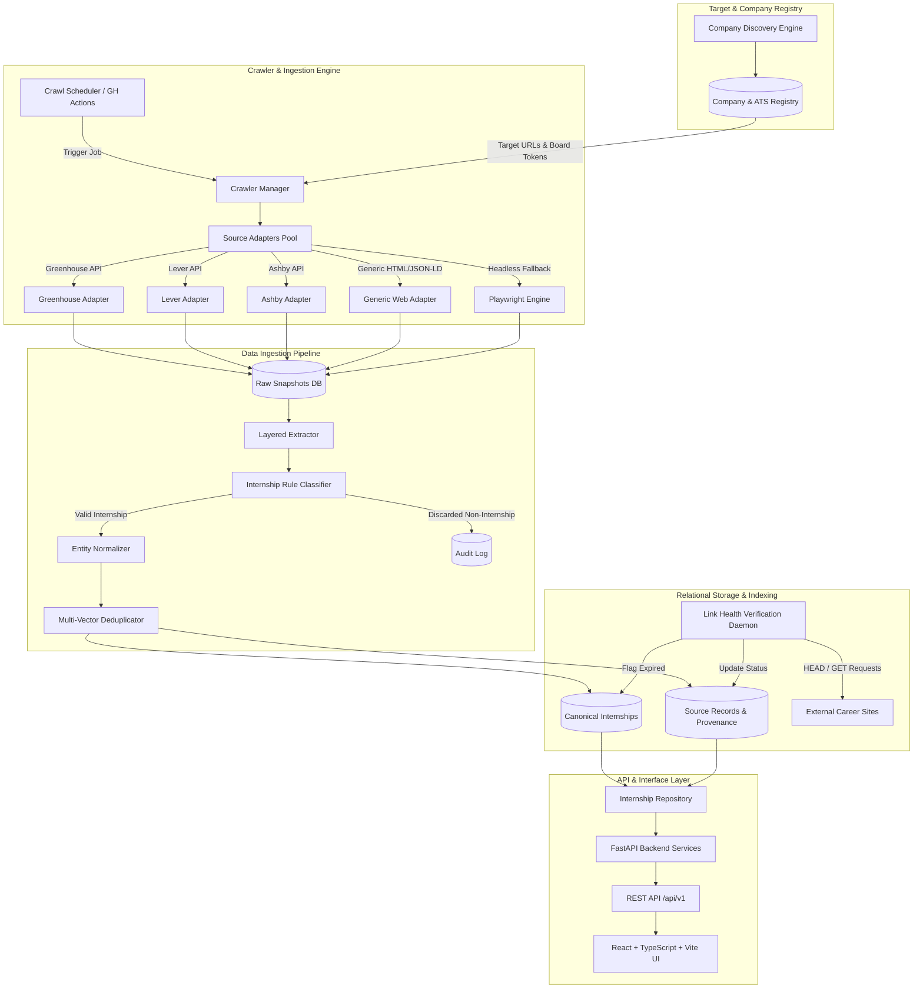
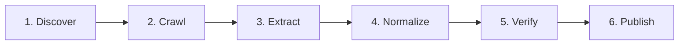
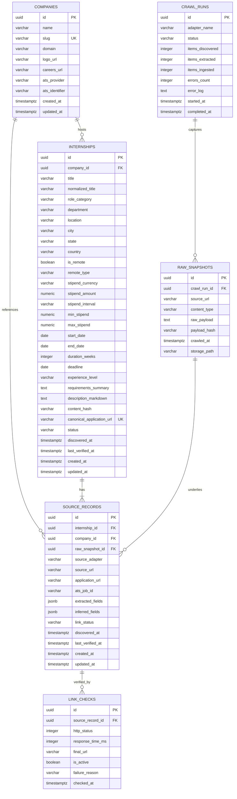
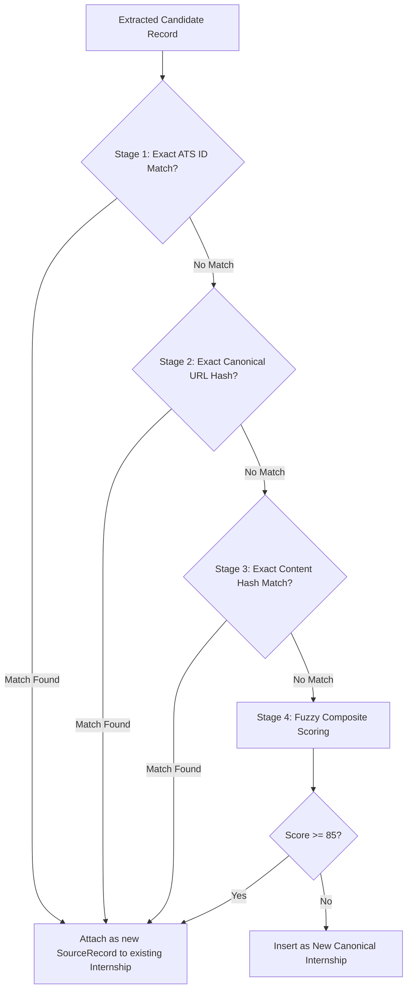
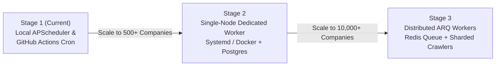

# System Design & Architecture Specification
**Internship Intelligence Engine**

---

## 1. High-Level Architecture

The platform architecture follows an event-driven, decoupled crawler and web aggregation topology designed for high throughput, verifiable provenance, and zero-hallucination extraction.



---

## 2. Data Flow per Pipeline Stage

The core data lifecycle executes across 6 deterministic stages:



### Stage 1: Discover
- **Objective**: Identify candidate companies and their respective ATS career endpoints.
- **Mechanism**: Inspect corporate web domains, find careers page links (`/careers`, `/jobs`), and fingerprint the hosting ATS via HTTP headers, HTML DOM clues, script tags, or DNS CNAMEs.
- **Output**: Populates `companies` table with `domain`, `careers_url`, `ats_provider`, and `ats_identifier`.

### Stage 2: Crawl
- **Objective**: Fetch job listings with politeness and zero disruption.
- **Mechanism**: Executes scheduled adapter runs against official public endpoints (e.g., `boards-api.greenhouse.io`). Employs HTTPX with backoff retries, connection pooling, and respectful `User-Agent` identifying the bot.
- **Output**: Writes an immutable payload snapshot to `raw_snapshots` along with its SHA-256 payload hash and records execution metadata in `crawl_runs`.

### Stage 3: Extract
- **Objective**: Parse structural attributes from payloads using a tiered extraction hierarchy.
- **Hierarchy**:
  1. **Official API**: Native JSON fields (`title`, `location`, `departments`, `content`).
  2. **JSON-LD Schema**: Schema.org `JobPosting` structured objects embedded in HTML.
  3. **Static DOM**: `selectolax` and `lxml` CSS selectors on semantic HTML tags.
  4. **Headless Browser**: Playwright execution only for client-side JavaScript applications where static HTML lacks content.
- **Output**: Emits unvalidated, strongly-typed `ExtractedJob` objects.

### Stage 4: Normalize
- **Objective**: Cleanse, standardize, and enforce strict data rules.
- **Rules**:
  - **Classification**: Validates internship indicators (e.g., "Intern", "Internship", "Co-op", "Fellow") while rejecting negative triggers ("Internal", "International", "Internet", "Senior", "Director", "Tenured").
  - **Text Sanitization**: Strips excessive whitespace, fixes broken Unicode via `ftfy`, and removes boilerplate recruiter jargon.
  - **Location & Remote**: Breaks down composite strings into `city`, `state`, `country`, and determines `is_remote` (`True`, `False`, or hybrid).
  - **Zero-Hallucination Guarantee**: If compensation, duration, or deadlines are not explicitly declared, the fields remain `null`. Never guess or impute numerical requirements.

### Stage 5: Verify
- **Objective**: Deduplicate opportunities and verify application link health.
- **Deduplication**: Match against existing records using exact ATS job IDs, canonical application URL hashes, content hashes, and RapidFuzz fuzzy similarity.
- **Health Daemon**: Performs async HTTP `HEAD` (or lightweight `GET`) requests to test for HTTP 404, 410, or redirect-to-homepage patterns, indicating closed positions.

### Stage 6: Publish
- **Objective**: Ingest into canonical database tables and index for high-speed queries.
- **Action**: Writes or updates `internships`, inserts `source_records` linking provenance, and makes records queryable via FastAPI endpoints.

---

## 3. Entity-Relationship (ER) Diagram



---

## 4. Indexing & Full-Text Search Plan

To ensure sub-20ms queries under heavy read traffic and multi-filter browsing:

### 1. B-Tree Indexes
- `companies(slug)`: Unique lookup by slug.
- `companies(ats_provider, ats_identifier)`: Fast lookups during crawler target discovery.
- `internships(company_id)`: Foreign key joins and per-company listings.
- `internships(canonical_application_url)`: Quick exact match during deduplication.
- `internships(content_hash)`: Quick hash dedup.
- `internships(status, created_at DESC)`: Standard active listing pagination.
- `internships(is_remote, country, role_category)`: Compound faceted filtering.
- `source_records(source_adapter, ats_job_id)`: Composite index for ATS-specific updates.

### 2. Full-Text Search (PostgreSQL GIN)
A generated `tsvector` column combining weighted searchable attributes:

$$\text{search\_vector} = \text{setweight}(\text{to\_tsvector}(\text{'english'}, \text{title}), 'A') \;\|\; \text{setweight}(\text{to\_tsvector}(\text{'english'}, \text{department}), 'B') \;\|\; \text{setweight}(\text{to\_tsvector}(\text{'english'}, \text{location}), 'C')$$

Indexed using:
```sql
CREATE INDEX idx_internships_search_vector ON internships USING GIN (search_vector);
```
Enables prefix matching, stemming, and relevance ranking via `ts_rank_cd()`.

---

## 5. Deduplication Algorithm & Scoring Weights

Internships frequently get posted with slight URL variations, query tracking parameters (`?gh_jid=...`, `?utm_source=...`), and subtle title differences ("Software Engineer Intern - Summer 2026" vs "2026 Summer Software Engineering Internship").

### Multi-Vector Deduplication Pipeline



### Scoring Weights

When falling back to Stage 4 fuzzy composite matching across records within the same employer:

| Attribute | Comparison Technique | Weight ($w_i$) | Threshold Requirement |
| :--- | :--- | :---: | :--- |
| **Company Match** | Strict UUID comparison | **35%** | Must match exactly (100% or abort) |
| **Normalized Title** | RapidFuzz `token_sort_ratio` | **35%** | Handles transposed terms ("Summer 2026 Intern") |
| **Location / Remote**| Normalized city/country or remote match | **20%** | Exact token overlap |
| **Department / Team**| String similarity | **10%** | Jaro-Winkler similarity |

### Decision Boundary
- **Composite Score $\ge 85$**: Identical opportunity. Update `last_verified_at`, record new `SourceRecord`.
- **Composite Score between $65$ and $84$**: Potential variant or distinct track (e.g., Backend vs Frontend). Flag for audit, create provisional separate record.
- **Composite Score $< 65$**: Confirmed distinct role. Ingest as new canonical `Internship`.

---

## 6. Scheduling & Incremental Update Strategy

### Incremental Crawling
1. **Conditional GETs & ETag / Last-Modified**: If supported by the ATS or host, crawler preserves `ETag` and skips unmodified payloads with HTTP 304.
2. **Payload Hash Check**: Before running full normalization pipelines, the SHA-256 hash of `raw_payload` is checked against the last snapshot. Unchanged listings simply bump `last_verified_at`.
3. **Stale Record Invalidation**: Jobs that are not seen across 3 consecutive crawl cycles (or that return HTTP 404/410 during link verification) transition from `active` to `expired`.

### Link Health Daemon
- Runs daily in the background.
- Employs an async worker pool issuing non-destructive HTTP `HEAD` requests.
- Validates that the URL returns 200 OK and does not redirect to a generic job portal home.

---

## 7. Failure Handling, Retries & Observability

### Resilient Networking
- Powered by `tenacity` on HTTP calls:
  - 3 retry attempts with exponential backoff and randomized jitter: $t_{wait} = 2^{\text{attempt}} + \text{uniform}(0, 1)$.
  - Triggers on network disconnects, timeouts, and HTTP 429/500/502/503/504 errors.
  - Aborts immediately on client errors (HTTP 400, 401, 403, 404).

### Observability Metrics
- **Job Yield**: Jobs extracted vs. filtered out per company.
- **Adapter Error Rate**: Recorded in `crawl_runs` (`errors_count` and stack trace logs).
- **Latency Distribution**: Request duration tracked per ATS provider to adjust concurrency limits dynamically.

---

## 8. Scaling Path: GitHub Actions → Dedicated Worker → ARQ + Redis



1. **Stage 1 (Current: 50–200 Companies)**:
   - Scheduled via GitHub Actions cron workflows and local APScheduler.
   - Synchronous or lightweight asyncio execution writing directly to PostgreSQL.
2. **Stage 2 (Mid-scale: 200–1,000 Companies)**:
   - Single containerized background service running continuous asynchronous crawler loops with concurrency limiters.
3. **Stage 3 (High-scale: 1,000–50,000 Companies)**:
   - Migration to **ARQ (async Redis queue)**:
     - Producer decomposes company crawl runs into discrete tasks.
     - Horizontally scaled async worker processes consume from Redis.
     - Rate limits enforced globally per ATS domain via Redis token buckets.

---

## 9. Trade-offs & Rejected Alternatives

| Alternative | Considered For | Verdict | Reason for Rejection |
| :--- | :--- | :--- | :--- |
| **Celery** | Task queue | **Rejected** | Heavyweight dependency footprint, complex broker configuration, dated asyncio integration compared to native async tools like ARQ. |
| **Apache Kafka** | Event streaming | **Rejected** | Massive operational overhead, unnecessary for hundreds of thousands of daily crawl events. Relational Postgres handles queueing and state transitions with lower complexity. |
| **Apache Airflow** | Workflow orchestration | **Rejected** | Over-engineered for web scraping, steep resource overhead, slow task iteration times, awkward dynamic DAG generation for thousands of dynamic company URLs. |
| **LLM Routine Parsing** | Entity extraction | **Rejected** | Prohibitive cost at web scale, unpredictable latency, hallucination risks on numerical fields (stipend, dates). Deterministic rules + selectolax + regex provide 100% deterministic accuracy at microseconds per page. |
